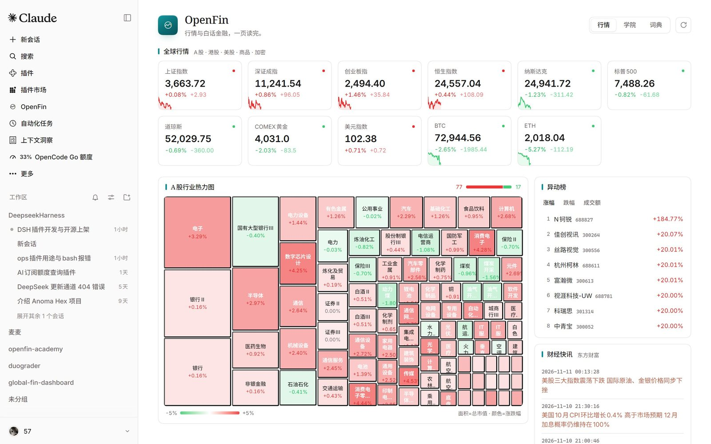
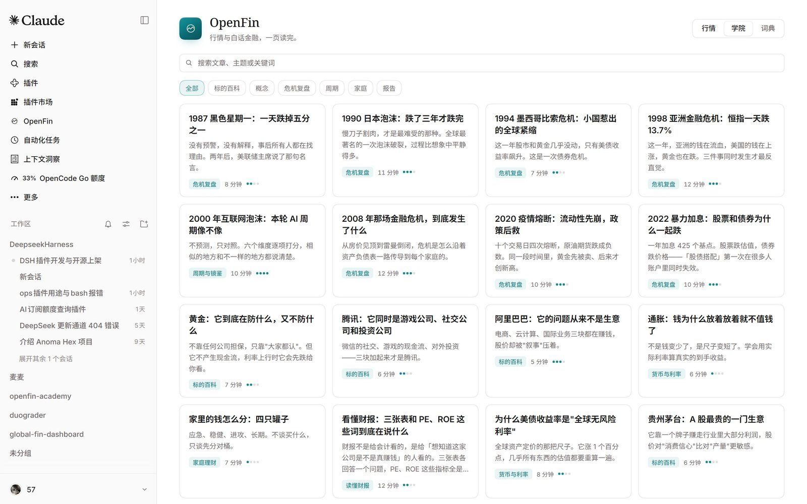
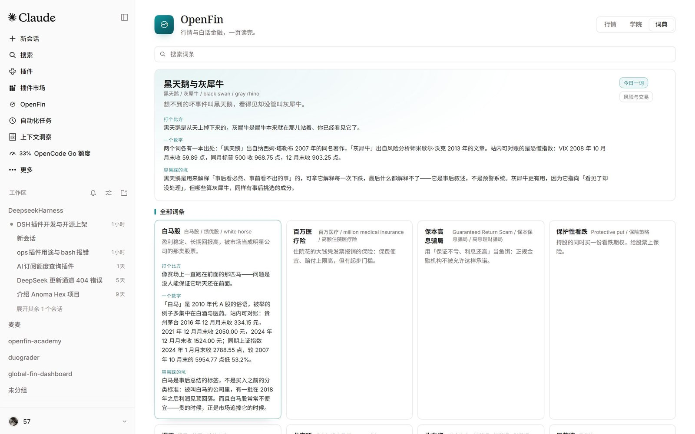
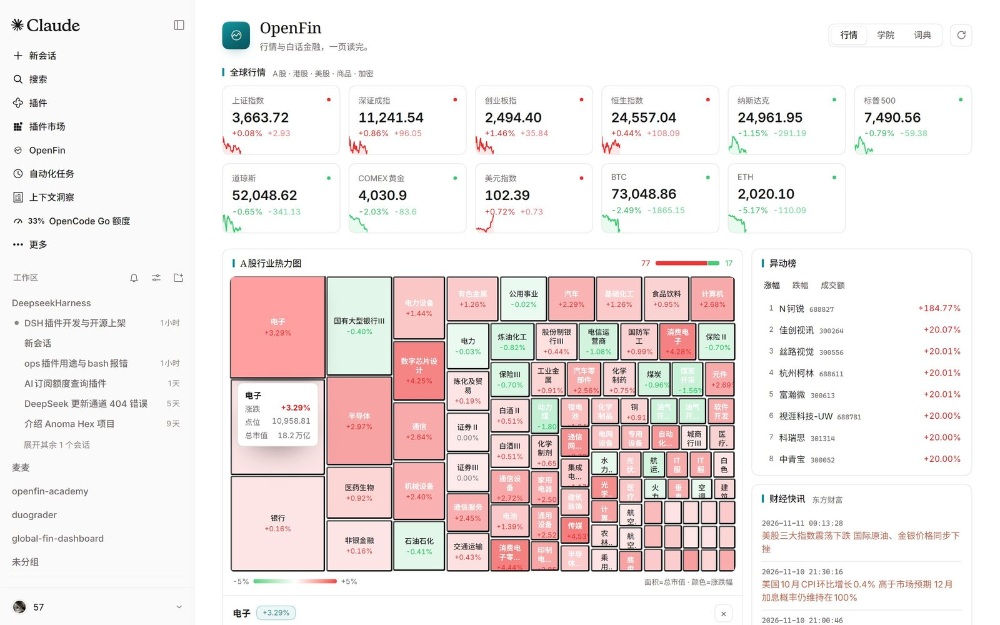
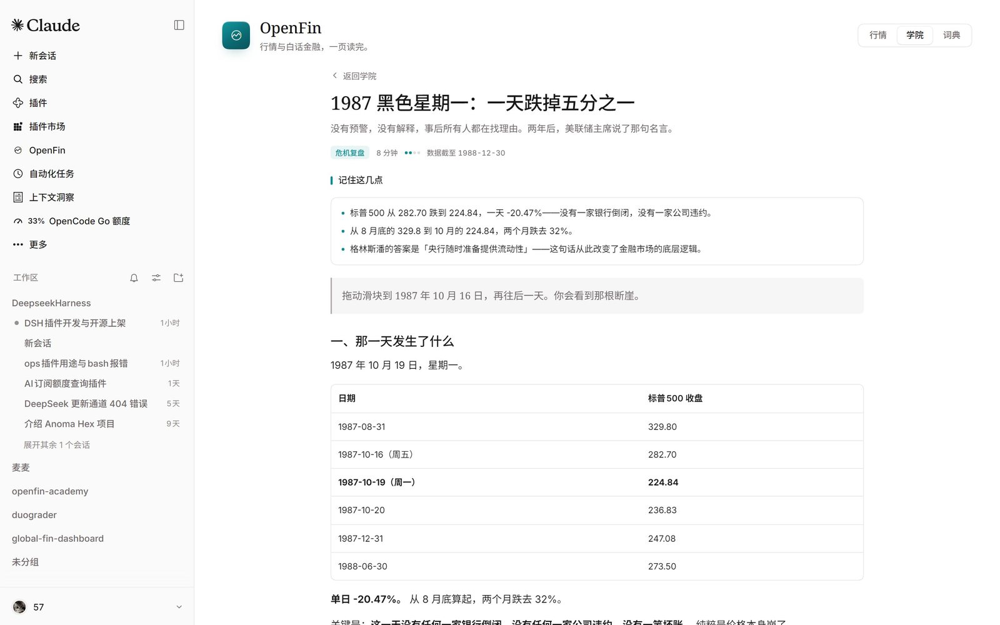

# dsh-openfin

English | [中文](README.md)

[](https://github.com/5777-wq/dsh-openfin/actions/workflows/ci.yml)
[](LICENSE)

> A finance dashboard and a plain-language finance library, installed into DeepSeek Harness as **one native page** — not an iframe, not an external link.



## What it is

OpenFin puts two things on one DSH page:

- **Markets** — 11 global instruments (Shanghai, Shenzhen, ChiNext, Hang Seng, Nasdaq, S&P 500, Dow, COMEX gold, dollar index, BTC, ETH), a market-cap treemap of 96 A-share industry sectors, gainers/losers/turnover lists, and an Eastmoney news feed. Click any sector to expand its constituents underneath the heatmap.
- **Academy** — 25 plain-language finance articles (7 crisis replays, 13 asset explainers, concepts and cycles) with glossary cross-links, plus a 293-term finance glossary with a term of the day.

The page is one row in the DSH sidebar that opens a full page. It follows the host theme (light, dark, or a community skin), locale (zh/en), and window width; motion only touches `transform`/`opacity` and respects `prefers-reduced-motion`.

| Academy | Glossary |
|---|---|
|  |  |

| Sector constituents | Article reader |
|---|---|
|  |  |

## Install

**Desktop:** open **Plugins → + Install** and paste

```text
github:5777-wq/dsh-openfin
```

**`dsh web`:**

```sh
dsh plugin --profile web add github:5777-wq/dsh-openfin
```

**Prebuilt tarball** (nothing to build, no `allowBuilds` prompt):

```sh
dsh plugin --profile web add https://github.com/5777-wq/dsh-openfin/releases/latest/download/dsh-openfin.tgz
```

After installing, click **OpenFin** in the sidebar. Refresh the page; if the row does not appear, restart DSH once.

## Requirements

- DeepSeek Harness **0.2.2-rc.1** or a later 0.2.x (`engines.dsh` is declared).
- Network access to public quote endpoints (Eastmoney / Binance / OKX / CoinGecko — any one reachable).
- No API key, no login, no Python, no local build.

## Data and privacy

- Quotes are fetched by the plugin's **Host half** inside the DSH process; the browser only talks to its own origin, so there is no CORS problem and no third-party origin in the page.
- Every request is an anonymous `GET`. The plugin uploads nothing, writes no files, and reads none of your files or sessions.
- A snapshot is cached for 30 s (the page polls using the `refreshMs` the server returns). If one upstream fails, the rest is served with a "partial data" badge instead of failing the page.
- Articles and glossary ship with the plugin, derived from the MIT-licensed sibling projects [openfin-academy](https://github.com/5777-wq/openfin-academy) and [openfinlens](https://github.com/5777-wq/openfinlens). Attribution in [NOTICE.md](NOTICE.md).

## Interactions

| Where | What |
|---|---|
| Sidebar **OpenFin** | Opens the page |
| **Markets** tab | Live quote cards; click a sector to expand constituents; switch movers between gainers/losers/turnover; news opens in a new tab |
| **Academy** tab | Search, filter by section, open an article; green term links open a definition |
| **Glossary** tab | Term of the day plus 293 terms; clicking a card expands metaphor/number/pitfall |
| Refresh button (top right) | Fetches a snapshot immediately (polling continues) |

## Development

```sh
npm install
npm run build        # emits the single-file ModuleLoader artifact at client/client.js
npm run check        # manifest, patch, locales, icon, artifact, generated data
node --test "tests/**/*.test.mjs"
```

Regenerate the bundled content from the sibling repositories:

```sh
node scripts/sync-academy.mjs --academy ../openfin-academy --openfinlens ../openfinlens
```

Layout:

```text
index.js                  Host half entry (registers /dsh-openfin routes)
lib/                      quote fetching, caching, snapshot assembly, academy data, HTTP routes
client/src/               page sources (React, bundled into one file)
client/client.js          committed build artifact (no build needed at install time)
data/                     article index, 25 article bodies, 293 glossary terms (generated)
locale/                   zh/en dictionaries (also read by the plugin manager)
docs/SPEC.md              interface and module contracts
```

## Known limits

- Quotes are an aggregation of public endpoints and may be late or missing; the page says so, and nothing here is investment advice.
- Article bodies are Chinese originals; the English UI translates interface copy only.
- Tested on DSH 0.2.2-rc.1 desktop and `dsh web` only.

## License

MIT. Third-party attribution and full license texts: [NOTICE.md](NOTICE.md) and [LICENSES/](LICENSES/).
