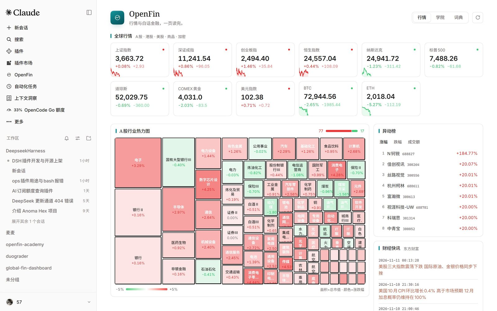
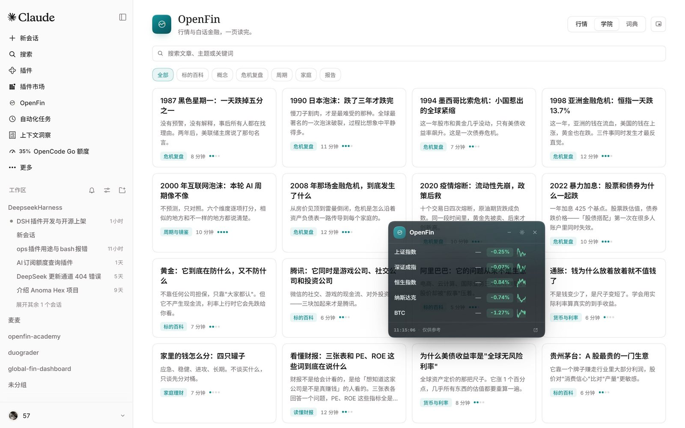
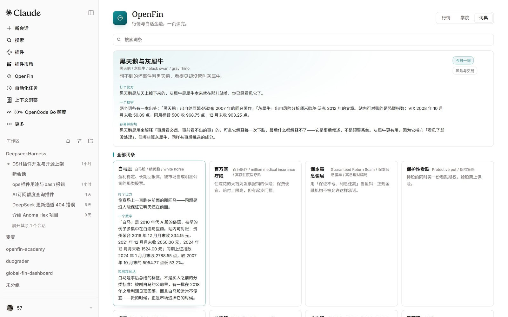
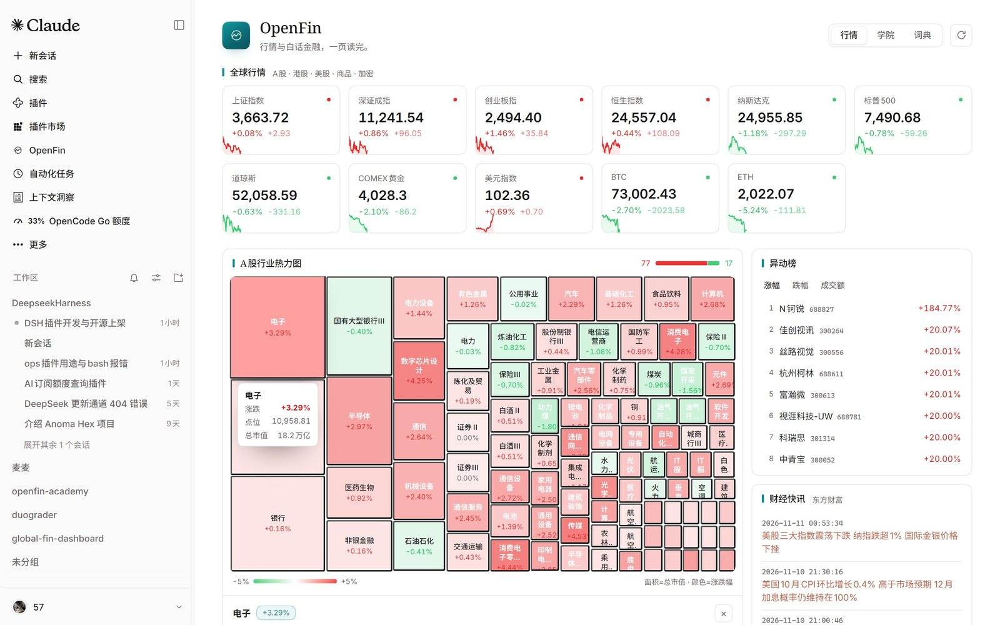
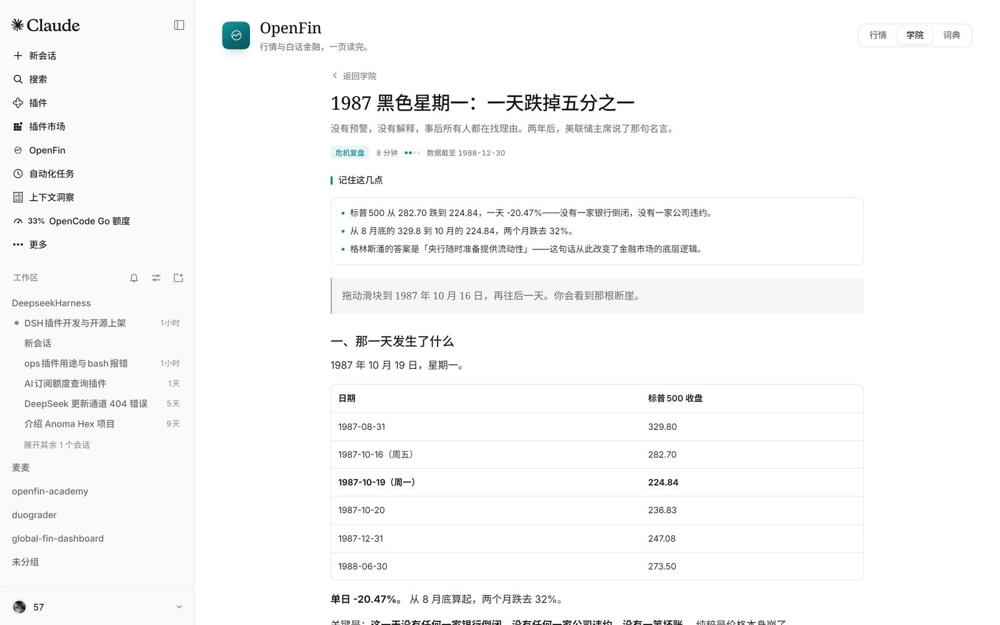
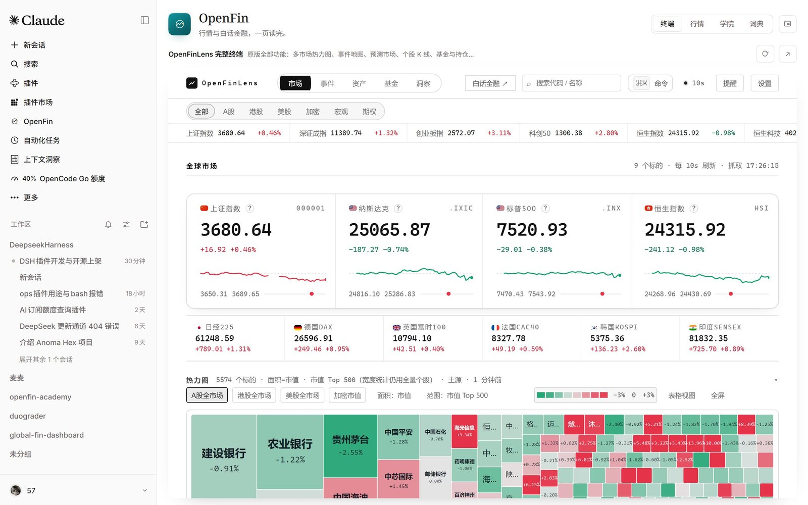
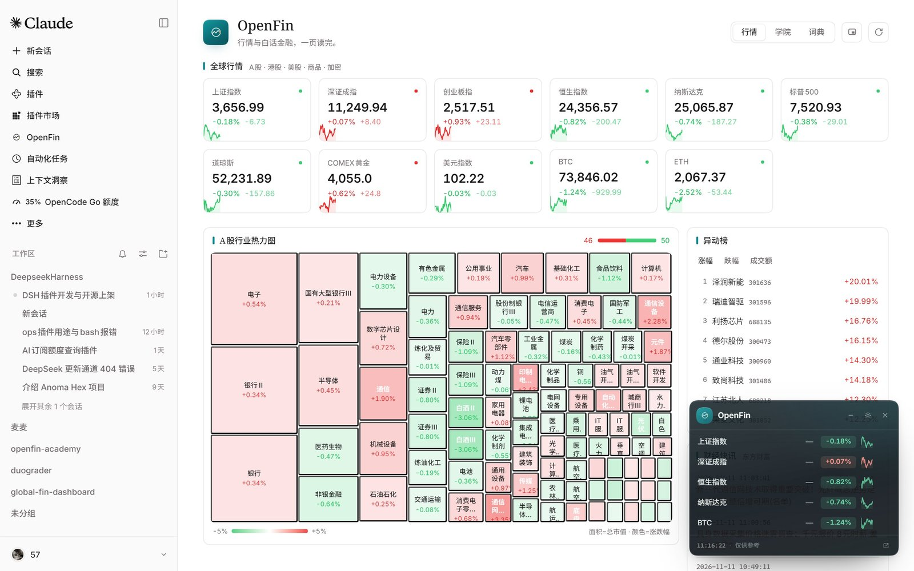
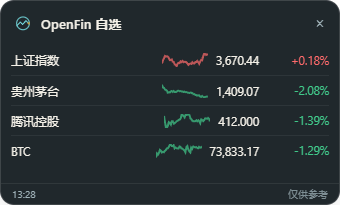
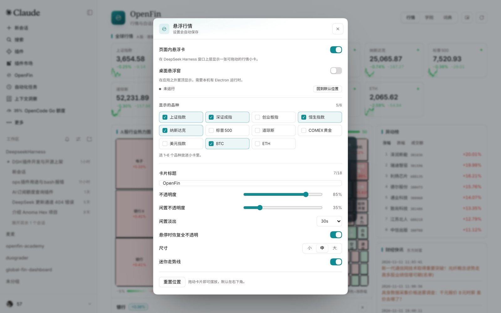

# dsh-openfin

[English](README.en.md) | 中文

[](https://github.com/5777-wq/dsh-openfin/actions/workflows/ci.yml)
[](LICENSE)

> 装进 DeepSeek Harness 的金融看板与白话学院：A股/港股/美股/商品/加密行情、行业热力图、异动榜、财经快讯，加上 25 篇白话金融文章与 293 条金融词典，全部作为 **DSH 里的一个原生页面**（不是 iframe，不是外链）。



## 它是什么

OpenFin 把两块东西放进同一个 DSH 页面：

- **完整终端（默认页签）**：就是 **OpenFinLens 原版应用**（MIT，仓库内 `lens/`，随插件发布），功能 1:1 而不是精简版——A股 5574 只 / 港股 / 美股 / 加密全市场热力图（市值·成交额·等面积、滚轮以光标为锚缩放、图例即筛选）、全球事件地图与市场预测、个股 K 线与 RSI/MACD/KDJ/BOLL、基金画像·测评·对比、持仓跟踪、宏观利率与资产矩阵、产业链与概念、龙虎榜/13F/南向资金、⌘K 命令面板、`#tab=` 深链、主源→备源→本地缓存的降级链。终端跟随宿主明暗主题，切页签不丢状态。
- **行情**：11 个全球标的（上证、深证、创业板、恒生、纳指、标普、道指、COMEX 黄金、美元指数、BTC、ETH）+ A股 96 个行业板块的市值热力图 + 涨跌幅/成交额异动榜 + 东方财富财经快讯。点任意板块，在热力图下方展开成分股。
- **学院**：`opencode` 式的白话金融读物——7 场危机复盘、13 个标的百科、概念与周期文章，共 25 篇，正文带术语链接；再加一个 293 条的金融词典（含「今日一词」）。
- **悬浮窗（摸鱼模式）**：一张可拖动的小卡片，页面内或**桌面置顶**都有——只显示你选的品种（内置 11 个，也可以搜索任意 A股/港股/美股加入自选），透明度、闲置淡出、卡片标题、尺寸都能调；收起时变成一颗会显示涨跌的吉祥物小球。还带一个**防老板快捷键**：按一下瞬间消失，再按一下恢复。

页面是 DSH 侧边栏里的一行，点开就是整页，跟随宿主主题（浅色/深色/第三方皮肤）、语言（中/英）与窗口宽度；动效只动 `transform`/`opacity`，并遵守 `prefers-reduced-motion`。

| 学院 | 词典 |
|---|---|
|  |  |

| 板块成分股 | 文章阅读 |
|---|---|
|  |  |

## 悬浮窗（摸鱼模式）

打开 **OpenFin → 右上角「悬浮行情设置」**：

- **页面内悬浮卡**：在 DSH 窗口里浮一张可拖动的小卡，默认右下角，收起后是 44px 的吉祥物小球，点一下展开。调节帕吉透明度（20–100%）、闲置 N 秒后自动淡到「闲置不透明度」、鼠标悬停恢复清晰。
- **桌面悬浮窗**：在应用之外开一个**透明置顶小窗**，DSH 被别的窗口盖住也看得见；原生窗口透明度、拖动记忆位置、关闭按钮即退出。需要本机有一份 Electron 运行时（其他 DSH 桌面插件通常已经放在 `$DSH_HOME/electron`；也可用 `DSH_OPENFIN_ELECTRON` 指定，或用 `PATH` 里的 `electron`）。
- **显示品种**：内置 11 个标的（上证/深证/创业板/恒生/纳指/标普/道指/黄金/美元指数/BTC/ETH）里选，或者在设置里搜索任意股票/基金/指数（输入「茅台」就能找到贵州茅台、五粮液等）加进自选；最多同时 6 个，按选择顺序显示。可选迷你走势线、自定义卡片标题（比如改成「监控」）、一键回默认位置。
- **防老板快捷键**：默认 `Ctrl+Shift+H`（设置里可换 `Alt+X` / `Ctrl+Alt+H` / `Ctrl+Shift+Space`，也可关闭）。按一次，页面内悬浮卡和桌面小窗一起瞬间消失；再按一次恢复。桌面小窗的快捷键是**系统级**的，DSH 不在前台也生效；如果这个组合被别的软件占用，页面内仍可用，桌面窗会在约 2 秒内跟随隐藏。

## 完整终端

「终端」页签里是原版 OpenFinLens 应用本体——22k 行原生 JS 的完整功能，不是重写的子集：

- 多市场热力图：A股 / 港股 / 美股 / 加密，市值·成交额·等面积三种面积口径，滚轮缩放、拖拽平移、图例色带当筛选器
- 事件：全球事件地图、市场预测（概率走势 / 档位环图）、龙虎榜、13F、南向资金
- 资产：个股 K 线与技术指标、多标的对比、基金画像/测评/持仓
- 洞察：中美国债曲线、大类资产矩阵、产业链与概念、世界银行年度热图
- ⌘K / Ctrl+K 命令面板、`#tab=` 深链、主源→备源→本地缓存的降级链

插件把它整包放进仓库（`lens/`，MIT，版本与 commit 记在 `lens/SOURCES.json`），由 Host 以同源静态资源提供、在 DSH 页面里全屏嵌入，并跟随宿主的明暗主题；升级只需跑 `npm run sync:lens` 重新同步。行情/学院/词典/悬浮窗仍是 DSH 原生适配界面。



| 页面内悬浮卡 | 桌面置顶小窗 |
|---|---|
|  |  |

| 悬浮设置 |
|---|
|  |

设置会记住（页面内配置与桌面窗共用一份），行情每 30 秒刷新一次；页面隐藏时暂停。

## 安装

> 已收录在 [DSH 插件市场](https://awesome-dsh-plugin.com/p/5777-wq/dsh-openfin/)（awesome-dsh-plugin，分类 UI Enhancements）。装了 [dsh-market](https://github.com/dsh-market/dsh-market) 的话，**设置 → 插件 → 市场** 里搜 `OpenFin` 就能一键装。

**桌面端**：打开 **插件** 页 → 右上 **+ 安装** → 粘贴

```text
github:5777-wq/dsh-openfin
```

**`dsh web`**：

```sh
dsh plugin --profile web add github:5777-wq/dsh-openfin
```

**预构建 tarball**（无需构建、无需 `allowBuilds`）：

```sh
dsh plugin --profile web add https://github.com/5777-wq/dsh-openfin/releases/latest/download/dsh-openfin.tgz
```

装完刷新页面，在侧边栏点 **OpenFin**；若侧边栏没有出现，重启一次 DSH。

## 需要什么

- DeepSeek Harness **0.2.2-rc.1** 或更新的 0.2.x（`engines.dsh` 已声明）。
- 能访问公开行情接口的网络（东方财富 / Binance / OKX / CoinGecko 任一可达）。
- 不需要 API key，不需要登录，不需要 Python 或本地编译。
- **桌面置顶悬浮窗**额外需要一份 Electron 运行时（自动探测 `$DSH_HOME/electron`、`DSH_OPENFIN_ELECTRON` 或 `PATH`；缺失时页面内悬浮卡仍照常可用）。

## 数据与隐私

- 行情由插件的 **Host 半场**在 DSH 进程里请求公开接口，浏览器只和 `127.0.0.1` 同源通信，因此没有浏览器 CORS 问题，也不暴露第三方域名给页面。
- 所有数据请求都是匿名 `GET`；插件不上报、不写盘、不读取你的任何文件与会话。
- 行情快照缓存 30 秒（页面按返回的 `refreshMs` 轮询）；单个上游失败时返回其余部分并标注「部分数据延迟」，不会整页报错。
- 文章与词典随插件发布，来自 MIT 协议的姊妹项目：[openfin-academy](https://github.com/5777-wq/openfin-academy)、[openfinlens](https://github.com/5777-wq/openfinlens)。署名见 [NOTICE.md](NOTICE.md)。

## 性能

- **只算一次**：词典 293 条构建一次（内容不随请求变，只有「今日一词」按本地日期滚动），文章解析结果按 mtime/size 复用，浏览器端把学院/词典/文章按页面生命周期缓存——切页签不再重新下载并解析 242 KB。
- **板块抽屉缓存 30 秒**：同一个板块反复打开不再发上游请求，单次最多等 5 秒。
- **悬浮窗与行情页共用一份行情缓存**：内置品种不再单独请求，自选品种与内置品种并行拉取。
- **单次上游请求有 5.5 秒总预算（含重试）**：不会再出现「4 秒超时 + 再试 4 秒」叠成 8 秒、而快照只等 6 秒的局面。加密行情降级链单独缓存且最多等 2 秒，不会拖住指数卡片。
- **客户端产物压缩发布**：单文件 222 KB → 143 KB（gzip 47 KB → 38 KB），每次打开 DSH 页面都要解析它。
- **页面隐藏时停止轮询**，回到前台立刻补一次；终端页签不再拉行情快照（那里不需要）。

## 交互

| 位置 | 操作 |
|---|---|
| 侧边栏 **OpenFin** | 打开整页 |
| **行情**页签 | 指数卡片实时刷新；点板块展开成分股；异动榜切涨幅/跌幅/成交额；快讯点开新标签 |
| **学院**页签 | 搜索、按栏目筛选、点卡片看正文；正文里的绿色术语可点开释义 |
| **词典**页签 | 今日一词 + 293 条词条；点卡片原地展开比喻/数字/坑 |
| 右上刷新按钮 | 立刻拉一次快照（轮询照常） |
| `Ctrl+Shift+H` | 悬浮窗瞬间隐藏 / 恢复（防老板快捷键） |

## 开发

```sh
npm install
npm run build        # 生成 client/client.js（单文件 ModuleLoader 产物）
npm run check        # 校验 manifest/补丁/locale/图标/产物/数据/终端
node --test "tests/**/*.test.mjs"
npm run sync:lens    # 从 ../openfin/openfinlens 重新同步完整终端（lens/）
node scripts/probe.mjs  # 可选：用真实上游跑一遍 Host 半场，打印冷/热耗时（需要网络）
```

内容来自姊妹仓库，重新生成：

```sh
node scripts/sync-academy.mjs --academy ../openfin-academy --openfinlens ../openfinlens
```

结构：

```text
index.js                  Host 半场入口（注册 /dsh-openfin 路由）
lib/                      行情抓取、缓存、快照组装、学院数据、HUD 管理、HTTP 路由
runtime/electron-helper/  桌面置顶悬浮窗（独立 Electron 进程，无依赖）
client/src/               页面源码（React，打包成单文件）
client/client.js          提交的构建产物（安装时不需要构建）
lens/                     完整 OpenFinLens 终端（原版 MIT 应用，sync 脚本生成）
data/                     文章索引、25 篇正文、293 条词典（由 sync 脚本生成）
locale/                   中英文字典（插件管理页也读这里）
docs/SPEC.md              接口与模块契约
```

## 已知边界

- 行情是公开接口的聚合，可能延迟或缺失；页面会标注，不构成投资建议。
- 桌面置顶窗在找不到 Electron 运行时的机器上不可用（会显示原因）；页面内悬浮卡不受影响。
- 桌面置顶窗按“置顶、不抢焦点”实现，不拦截其他应用的鼠标；如需完全隐形，把透明度调低或直接关闭。
- 自选标的依赖东方财富的公开搜索/报价接口；个股停牌或接口缺失时该行会暂时留空，其余标的照常显示。
- 「终端」页签是**原版 OpenFinLens 的同源内嵌**（为了功能 1:1）。它的本地存储键是 `gfd_*` / `ofl:*`，与插件的 `dsh-openfin:*` 不冲突；宿主明暗主题会传给终端，但终端内已经打开的 Canvas 图表在切换明暗后可能需要重新进入该页才会换色。
- 学院正文是中文原文；英文界面只翻译界面文案。
- 仅测试了 DSH 0.2.2-rc.1 桌面端与 `dsh web`。

## 许可

MIT。第三方署名与许可全文见 [NOTICE.md](NOTICE.md) 与 [LICENSES/](LICENSES/)。
